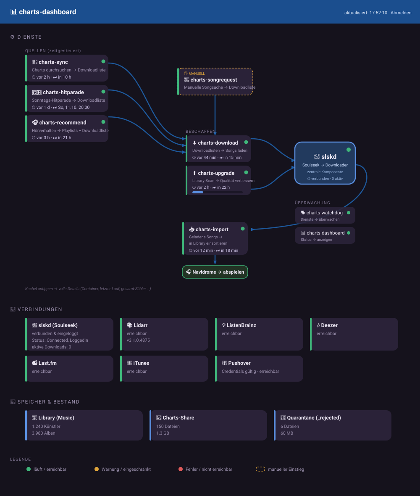

> 🇬🇧 English version. Deutsche Version: [README.md](README.md)

# charts-dashboard

Status web UI for the charts-stack. Shows at a glance whether all services are
running, whether the connections are healthy, and what each service processed
last.

Monitoring service of the `charts-*` family, together with
[`charts-watchdog`](../charts-watchdog) (Pushover alerts without a UI).

---

## Layout

The services are shown as a **data flow** – at a glance you see what flows
where, what runs automatically and what is started manually. **slskd** sits at
the centre as the hub every download passes through.

- **Sources** (scheduled) produce download lists: `charts-sync`,
  `charts-hitparade`, `charts-recommend`. `charts-songrequest` is the **manual**
  entry point (marked "MANUAL" on its tile).
- **Fetch:** `charts-download` (from the download lists) and `charts-upgrade`
  (library scan for poor quality) trigger downloads via **slskd**.
- **Import:** `charts-import` files the downloaded songs, tagged, into the
  library → **Navidrome** (external target, drawn as a green pill).
- **Monitoring & report:** `charts-watchdog`, `charts-dashboard`,
  `charts-digest` (daily Pushover summary) and `charts-config` (snippet/config
  UI) sit on the right in their own "monitoring & report" zone (not in the data
  flow), as stacked tiles with even spacing.

> **A service box is missing?** Services that write **no** status file
> (`charts-watchdog`, `charts-dashboard`) are only shown if they are listed in
> the `WATCH_CONTAINERS` variable (central `.env`). If a box does not appear,
> check there first – the `.env` overrides the code default.

Each service tile compactly shows a status light, "what → where" and **when it
last ran / when next**; a click/tap expands the full details (container state,
last run, cumulative totals, and for `charts-upgrade` the scan progress).
`slskd` is expanded by default as the central component. The tiles can be
**dragged freely** with the mouse on desktop or by touch on a wide-screen touch
device (e.g. an iPad) (the connection lines follow); a reload restores the
default arrangement.

## What it shows

- **Connections:** an overview of all external/dependent services with a
  consistent colour semantic – **green** = reachable/valid, **red** = configured
  but unreachable/invalid, **grey** = not configured, **yellow** = reachable but
  limited (e.g. iTunes throttled). The tiles are grouped into **three labelled
  role groups**:
  - **Local services** – your own infrastructure: slskd (logged in to the
    Soulseek server? active downloads) and Lidarr.
  - **Chart sources** – where the charts/songs come from: Deezer, Last.fm,
    **FLASHBACK FM** (GraphQL live check of the LastPlayed query: a dead
    persisted-query hash → red tile → signal "refresh `FLASHBACK_HASH`"; without
    a hash grey/muted) and **Energy (NRJ)** (⚡, live ICY reachability of the
    Swiss NRJ Icecast stream that [`charts-energy`](../charts-energy) reads).
  - **Helper services** – metadata/recommendation helpers, not chart sources:
    **MusicBrainz** (🏷, live reachability of the metadata/year-lookup helper),
    iTunes (covers), Pushover and **ListenBrainz** (it provides recommendations,
    not charts, so it sits here rather than under chart sources).
  - **Muted "not in use" state:** the **Energy (NRJ)** and **MusicBrainz** tiles
    are not pinged when their feature is off; they show a greyed-out **"not in
    use"** badge instead. This is driven by the existing `ENERGY_ENABLED` /
    `MB_ENABLED` flags (set one to `0` and the matching tile is muted rather than
    probed).

  One glance shows every possible connection and its live state.
- **Services:** per container the Docker state (running / healthy / stopped) in
  processing-chain order, plus the **exact run stats**: when the last run was,
  whether it succeeded, what it processed (e.g. "6 imported, 2 skipped") and the
  cumulative totals. The "next run" label deliberately shows **hours AND minutes**
  in the 1–24 h range (e.g. "in 1 h 50 min"), so 1h50 is not misleadingly shown
  as "in 1 h"; an overdue run is honestly labelled "overdue".
- **Storage & inventory:** file count/size of the charts share and the quarantine.

The page refreshes automatically (default every 15 s).

The dashboard is a **pure status monitor**: it shows state, connections and run
stats, nothing more. The source finder and the Energy-channel browser that used
to live here moved to the sibling service **[`charts-config`](../charts-config)**
(own web UI on port 5058). The dashboard still renders a **charts-config tile**
in the monitoring zone so you can see at a glance whether that service is up.

## Where the data comes from

- **Container state:** read-only through the `charts-docker-proxy` (`inspect`),
  **not** directly via the Docker socket.
- **slskd / Lidarr:** direct API query (`/api/v0/server` and `system/status`).
- **External live checks:** cheap pings against ListenBrainz, Deezer, Last.fm,
  iTunes, Pushover and FLASHBACK FM – cached (default 120 s, decoupled from the
  15 s poll). ListenBrainz/Deezer/Last.fm **heal** a stored `error` of the related
  service: if the source is live-reachable, the service tile turns **yellow**
  ("running again") instead of hard **red**. FLASHBACK FM is checked via its
  GraphQL LastPlayed query and heals `charts-flashback` the same way; a dead
  persisted-query hash turns the tile red (signal: refresh `FLASHBACK_HASH`),
  without a hash it stays grey. iTunes (covers) and Pushover are info-only and
  heal **no** service red. Pushover now checks its credentials with a real
  `validate` call (consumes no message budget) instead of only showing a
  configured flag. Last.fm needs an API key – without one the tile stays grey
  (not red).
- **Run stats:** each charts service writes a small JSON file to
  `Charts/.charts-status/<service>.json` at the end of a run. The dashboard only
  reads these files – no log parsing, no runtime coupling to the services.

## Login

The dashboard has its **own** login, separate from charts-songrequest (it shows
internal state):

- `DASHBOARD_USERNAME` (default `admin`) + `DASHBOARD_PASSWORD`.
- If `DASHBOARD_PASSWORD` is empty, it falls back to the shared
  `APP_USERS`/`APP_PASSWORD`.

Without a valid login the service refuses to start (the page may be exposed).

## Configuration (central `.env`)

| Variable | Default | Purpose |
| --- | --- | --- |
| `DASHBOARD_PORT` | `5057` | host port of the web UI |
| `DASHBOARD_REFRESH_SECONDS` | `15` | auto-refresh interval |
| `CHARTS_LANG` | – (empty = English) | language for the UI **and** logs (`de`/`fr` available) – one stack-wide switch, no in-UI toggle |
| `DASHBOARD_DONATE` | `1` | discreet donate footer (PayPal/Revolut); `0`/`false`/`no` hides it |
| `DASHBOARD_USERNAME` | `admin` | dashboard username |
| `DASHBOARD_PASSWORD` | – | password (empty = fall back to `APP_USERS`) |
| `SLSKD_API_KEY` | – | for slskd status (required in the stack) |
| `LIDARR_URL` / `LIDARR_API_KEY` | – | optional, for the Lidarr check |
| `LASTFM_API_KEY` | – | optional, for the Last.fm live check (empty = tile grey) |
| `PUSHOVER_TOKEN` / `PUSHOVER_USER` | – | optional, for the Pushover `validate` check |
| `ENERGY_ENABLED` | `0` | existing charts-energy flag – `0` mutes the Energy (NRJ) tile ("not in use") instead of pinging it |
| `MB_ENABLED` | `1` | existing stack-wide flag – `0` mutes the MusicBrainz tile ("not in use") instead of pinging it |
| `DASHBOARD_EXTERNAL_TTL` | `120` | cache TTL of the external live checks (seconds) |
| `WATCH_CONTAINERS` | all charts services | which containers are shown – services **without** a status file (e.g. `charts-watchdog`, `charts-dashboard`) only appear if listed here |

## Access

On the LAN directly via `http://<host>:5057`. For external access put it behind a
reverse proxy (e.g. `status.your-domain.tld` → `http://<host>:5057`, no WebSocket
needed) and use **HTTPS** – the login uses a session cookie.

## Security

- Runs as an **unprivileged user** (youruser, `PUID:PGID`), **not** as root.
- **No** direct Docker socket access: container states are queried **read-only**
  only through the `charts-docker-proxy`
  (`DOCKER_HOST=tcp://charts-docker-proxy:2375`). The proxy only allows read
  requests – starting/stopping/exec of containers is blocked.
- Mounts Charts/Music **read-only**.

## Language & donations

- The dashboard follows the stack-wide `CHARTS_LANG` (empty = English; `de`/`fr`
  available). One switch for the whole stack, no in-UI toggle – change the
  language by editing the `.env` and restarting the container (no rebuild; the
  language files come read-only from the `/lang` mount).
- A discreet **donate footer** (PayPal/Revolut) is on by default and can be
  turned off with `DASHBOARD_DONATE=0`.
- Note: the two donate URLs live in **two** places – the footer in
  `app/static/index.html` (via `_DONATE_FOOTER` in `app/main.py`) and
  `.github/FUNDING.yml` (GitHub reads that file statically). They are
  **intentionally independent** – if a handle changes, update both.
