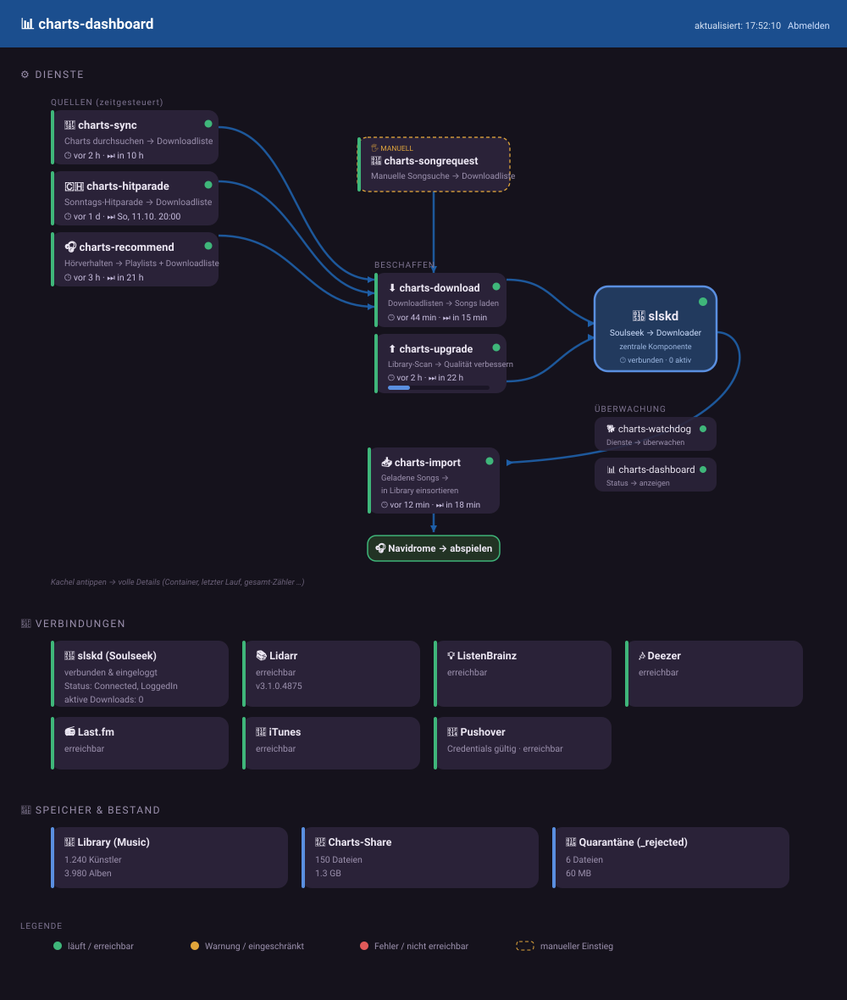

# charts-dashboard

Status-Weboberfläche für den charts-stack. Zeigt auf einen Blick, ob alle Dienste
laufen, ob die Verbindungen gesund sind und was jeder Dienst zuletzt verarbeitet
hat.

Monitoring-Dienst der `charts-*`-Familie, zusammen mit
[`charts-watchdog`](../charts-watchdog) (Pushover-Alarm ohne UI).

---

## Aufbau

Die Dienste werden als **Datenfluss** dargestellt – man sieht auf einen Blick,
was wohin fließt, was automatisch läuft und was manuell gestartet wird. **slskd**
steht als zentrale Komponente im Zentrum, durch die alle Downloads laufen.

- **Quellen** (zeitgesteuert) erzeugen Downloadlisten: `charts-sync`,
  `charts-hitparade`, `charts-recommend`. `charts-songrequest` ist der **manuelle**
  Einstieg (mit „MANUELL"-Markierung in der Kachel).
- **Beschaffen:** `charts-download` (aus den Downloadlisten) und `charts-upgrade`
  (Library-Scan auf schlechte Qualität) stoßen Downloads über **slskd** an.
- **Einsortieren:** `charts-import` legt die geladenen Songs getaggt in die
  Library → **Navidrome** (externes Ziel, als grüne Pille dargestellt).
- **Überwachung & Report:** `charts-watchdog`, `charts-dashboard`,
  `charts-digest` (tägliche Pushover-Zusammenfassung) und `charts-config`
  (Snippet-/Konfig-UI) stehen rechts in einer eigenen „Überwachung & Report"-Zone
  (nicht im Datenfluss), als gestapelte Kacheln mit gleichmäßigem Abstand.

> **Fehlt eine Dienst-Box?** Dienste, die **keine** Statusdatei schreiben
> (`charts-watchdog`, `charts-dashboard`), werden nur angezeigt, wenn sie in der
> `WATCH_CONTAINERS`-Variable (zentrale `.env`) gelistet sind. Taucht eine Box
> nicht auf, zuerst dort prüfen – die `.env` überschreibt den Code-Default.

Jede Dienste-Kachel zeigt kompakt Status-Ampel, „was → wohin" und **wann zuletzt
gelaufen / wann wieder**; ein Klick/Tap klappt die vollen Details auf
(Container-Zustand, letzter Lauf, kumulative Gesamtzahlen, bei `charts-upgrade`
der Scan-Fortschritt). `slskd` ist als zentrale Komponente standardmäßig
aufgeklappt. Die Kacheln lassen sich am Desktop mit der Maus und auf einem
Touch-Gerät mit breitem Bildschirm (z. B. iPad) per Finger **frei verschieben**
(Verbindungslinien folgen); ein Reload stellt die Standard-Anordnung wieder her.

## Was es zeigt

- **Verbindungen:** eine Übersicht aller externen/abhängigen Dienste mit
  einheitlicher Farbsemantik – **grün** = erreichbar/gültig, **rot** =
  konfiguriert aber nicht erreichbar/ungültig, **grau** = nicht konfiguriert,
  **gelb** = erreichbar aber eingeschränkt (z. B. iTunes gedrosselt). Die
  Kacheln sind in **drei beschriftete Rollen-Gruppen** aufgeteilt:
  - **Lokale Dienste** – deine eigene Infrastruktur: slskd (beim Soulseek-Server
    eingeloggt? aktive Downloads) und Lidarr.
  - **Chart-Quellen** – woher die Charts/Songs kommen: Deezer, Last.fm,
    **FLASHBACK FM** (GraphQL-Live-Check der LastPlayed-Query: toter
    persisted-query-Hash → rote Kachel → Signal „`FLASHBACK_HASH` neu holen";
    ohne Hash grau/muted) und **Energy (NRJ)** (⚡, Live-ICY-Erreichbarkeit des
    Schweizer NRJ-Icecast-Streams, den [`charts-energy`](../charts-energy) liest).
    **Schweizer Hitparade** prüft die aktuelle Singles-Seite
    (`https://hitparade.ch/charts/singles`), nicht den nicht vorhandenen
    `/charts`-Index. Die Kachel zeigt die Erreichbarkeit, nicht den Erfolg des
    letzten Wochenlaufs; dessen Ergebnis steht in der Dienst-Kachel.
    **Apple Music Charts** hat eine eigene Kachel, getrennt von iTunes:
    `APPLE_CHARTS_ENABLED=1` aktiviert den Live-Check des öffentlichen
    Most-played-Feeds für `APPLE_CHARTS_COUNTRY` (Default `ch`).
    HTTP-Fehler, leere oder ungültige Titel führen zu Rot; ohne Aktivierung
    bleibt die Kachel grau und es erfolgt kein Abruf.
  - **Hilfsdienste** – Metadaten-/Empfehlungs-Helfer, keine Chart-Quellen:
    **MusicBrainz** (🏷, Live-Erreichbarkeit des Metadaten-/Jahr-Lookup-Helfers),
    iTunes (Cover), Pushover und **ListenBrainz** (liefert Empfehlungen, keine
    Charts, und steht deshalb hier statt bei den Chart-Quellen).
  - **Nicht konfiguriert:** slskd, Lidarr, Last.fm, Apple Music Charts,
    FLASHBACK FM, Energy, Schweizer Hitparade, MusicBrainz und Pushover zeigen
    bei fehlenden nötigen Zugangsdaten/URLs bzw. deaktiviertem Live-Check
    einheitlich einen grauen Status **„nicht konfiguriert"**. Ein zusätzlicher
    Grund wie „kein API-Key" erscheint höchstens einmal. Ohne Konfiguration
    erfolgt kein Abruf; bei slskd entfallen auch Verbindungs-/Downloadzahlen.
    Öffentliche Dienste ohne nötige Zugangsdaten (Deezer, ListenBrainz, iTunes)
    behalten ihren Live-Status. Die bestehenden Warnfarben für reine
    Metadaten-Helfer bleiben unverändert.
    Bei Transportfehlern stehen Status und Diagnose getrennt: z. B.
    „nicht erreichbar“ und „Fehler: ReadTimeout“, ohne wiederholten Statustext.

  So sieht man auf einen Blick alle möglichen Verbindungen und ihren
  Live-Zustand.
- **Dienste:** je Container der Docker-Zustand (läuft / healthy / gestoppt) in
  der Reihenfolge der Verarbeitungskette, plus die **exakte Lauf-Statistik**:
  wann der letzte Lauf war, ob er erfolgreich war, was er verarbeitet hat
  (z. B. „6 importiert, 2 übersprungen") und die kumulativen Gesamtzahlen. Die
  „nächster Lauf"-Angabe nennt im Bereich 1–24 h bewusst **Stunden UND Minuten**
  (z. B. „in 1 h 50 min"), damit 1h50 nicht irreführend als „in 1 h" erscheint;
  ein überfälliger Lauf wird ehrlich als „überfällig" angezeigt.
- **Speicher & Bestand:** Dateizahl/Größe des Charts-Share und der Quarantäne.

Die Seite aktualisiert sich automatisch (Standard: 15 s nach Abschluss der
vorherigen Prüfung). Abfragen desselben Browser-Tabs überlappen nicht.
Beim ersten Laden steht eine dunkle Lade-Karte mit Erklärung und Wartezeit
statt einer leeren Ansicht; die Status-Ampel ist während der Prüfung gelb.
Ein Live-Text pro Prüfgruppe zeigt **wartet → in Prüfung → geprüft**, ergänzt
um die Zahl abgeschlossener Gruppen. Diese Meldungen kommen aus der laufenden
Abfrage, nicht aus einem Animationstimer. **Geprüft** bedeutet abgeschlossen,
nicht zwangsläufig erreichbar oder gesund; das Ergebnis erscheint danach in
den Status-Kacheln.
Container, slskd, Lidarr, externe Quellen, Speicher und laufende Vorgänge werden
als unabhängige Gruppen parallel geprüft. Einzelne WAN-Prüfungen können
weiterhin dauern. Die Status-Abfrage blockiert nicht den Webserver-Eventloop.
Nach spätestens zwei Minuten bricht der Browser die Anfrage ab, zeigt einen
Fehler und versucht es erneut. Bereits angezeigte Daten bleiben bei einem
fehlgeschlagenen Refresh sichtbar, mit roter Aktualisierungsanzeige.
Die Oberfläche nutzt den authentifizierten NDJSON-Stream
`/api/status/stream`; `/api/status` bleibt als vollständige JSON-Antwort
kompatibel. Ein vorgeschalteter Reverse Proxy darf Streaming-Antworten nicht
puffern, sonst erscheinen Zwischenmeldungen erst verspätet.

Das Dashboard ist ein **reiner Status-Monitor**: es zeigt Zustand, Verbindungen
und Lauf-Statistik, mehr nicht. Der Quellen-Finder und der Energy-Kanal-Browser,
die früher hier lagen, sind in den Schwester-Dienst
**[`charts-config`](../charts-config)** gewandert (eigene Web-UI auf Port 5058).
Das Dashboard zeigt weiterhin eine **charts-config-Kachel** in der
Überwachungs-Zone, damit man auf einen Blick sieht, ob dieser Dienst läuft.

## Woher die Daten kommen

- **Container-Zustand:** read-only über den `charts-docker-proxy` (`inspect`),
  **nicht** direkt über den Docker-Socket.
- **slskd / Lidarr:** direkte API-Abfrage (`/api/v0/server` bzw. `system/status`).
- **Externe Live-Checks:** billige Pings gegen ListenBrainz, Deezer, Last.fm,
  optional Apple Music Charts, iTunes, Pushover und FLASHBACK FM – gecacht (Default 120 s, entkoppelt vom
  15-s-Poll).
  ListenBrainz/Deezer/Last.fm/Apple Music **heilen** einen gespeicherten `error` des
  zugehörigen Dienstes: ist die Quelle live erreichbar, wird die Dienste-Kachel
  **gelb** („läuft wieder") statt hart **rot**. FLASHBACK FM wird per
  GraphQL-LastPlayed-Query geprüft und heilt `charts-flashback` genauso; ein
  toter persisted-query-Hash macht die Kachel rot (Signal: `FLASHBACK_HASH` neu
  holen), ohne Hash bleibt sie grau. iTunes (Cover) und Pushover sind
  reine Info und heilen **kein** Dienste-Rot. Pushover prüft die Credentials jetzt
  mit einem echten `validate`-Call (verbraucht kein Nachrichten-Budget) statt nur
  ein configured-Flag anzuzeigen. Last.fm braucht einen API-Key – ohne Key bleibt
  die Kachel grau (nicht rot).
  Diese Live-Anzeige macht den vergangenen Lauf nicht nachträglich erfolgreich:
  für einen erfolgreichen gespeicherten Laufstatus und eine entsprechende
  Watchdog-Entwarnung muss der Dienst erneut erfolgreich laufen.
- **Lauf-Statistik:** jeder charts-Dienst schreibt am Ende eines Laufs eine kleine
  JSON-Datei nach `Charts/.charts-status/<dienst>.json`. Das Dashboard liest nur
  diese Dateien – kein Log-Parsing, keine Laufzeit-Kopplung an die Dienste.

## Login

Das Dashboard hat einen **eigenen** Login, getrennt von charts-songrequest (es
zeigt interne Zustände):

- `DASHBOARD_USERNAME` (Default `admin`) + `DASHBOARD_PASSWORD`.
- Ist `DASHBOARD_PASSWORD` leer, fällt es auf die gemeinsamen
  `APP_USERS`/`APP_PASSWORD` zurück.

Ohne gültigen Login startet der Dienst nicht (die Seite kann von außen erreichbar
sein).

## Konfiguration (zentrale `.env`)

| Variable | Default | Zweck |
| --- | --- | --- |
| `DASHBOARD_PORT` | `5057` | Host-Port der Web-UI |
| `DASHBOARD_REFRESH_SECONDS` | `15` | Auto-Refresh-Intervall |
| `CHARTS_LANG` | – (leer = Englisch) | Sprache für UI **und** Logs (`de`/`fr` verfügbar) – stackweiter Schalter, kein eigener UI-Umschalter |
| `DASHBOARD_DONATE` | `1` | dezenter Spenden-Footer (PayPal/Revolut); `0`/`false`/`no` blendet ihn aus |
| `DASHBOARD_USERNAME` | `admin` | Benutzername fürs Dashboard |
| `DASHBOARD_PASSWORD` | – | Passwort (leer = Fallback auf `APP_USERS`) |
| `SLSKD_API_KEY` | – | für slskd-Status (Pflicht im Stack) |
| `LIDARR_URL` / `LIDARR_API_KEY` | – | optional, für den Lidarr-Check |
| `LASTFM_API_KEY` | – | optional, für den Last.fm-Live-Check (leer = Kachel grau) |
| `APPLE_CHARTS_ENABLED` | `0` | Apple-Music-Charts überwachen; aktiviert selbst keinen Sync-Feed |
| `APPLE_CHARTS_COUNTRY` | `ch` | Überwachtes Land; passend zum gewünschten Apple-Feed setzen |
| `PUSHOVER_TOKEN` / `PUSHOVER_USER` | – | optional, für den Pushover-`validate`-Check |
| `ENERGY_ENABLED` | `0` | bestehendes charts-energy-Flag – `0` setzt die Energy-(NRJ)-Kachel auf „not in use" statt sie zu pingen |
| `MB_ENABLED` | `1` | bestehendes stackweites Flag – `0` setzt die MusicBrainz-Kachel auf „not in use" statt sie zu pingen |
| `DASHBOARD_EXTERNAL_TTL` | `120` | Cache-TTL der externen Live-Checks (Sekunden) |
| `WATCH_CONTAINERS` | alle charts-Dienste | welche Container angezeigt werden – Dienste **ohne** Statusdatei (z. B. `charts-watchdog`, `charts-dashboard`) erscheinen NUR, wenn sie hier gelistet sind |

## Zugriff

Im LAN direkt über `http://<host>:5057`. Für den Zugriff von außen hinter einen
Reverse Proxy legen (z. B. `status.deine-domain.tld` → `http://<host>:5057`,
kein WebSocket nötig) und **HTTPS** verwenden – das Login nutzt ein Session-Cookie.

## Sicherheit

- Läuft als **unprivilegierter User** (youruser, `PUID:PGID`), **nicht** als root.
- **Kein** direkter Docker-Socket-Zugriff: Container-Zustände werden ausschließlich
  **read-only** über den `charts-docker-proxy` abgefragt
  (`DOCKER_HOST=tcp://charts-docker-proxy:2375`). Der Proxy lässt nur lesende
  Abfragen durch – Container starten/stoppen/exec ist blockiert.
- Mountet Charts/Music **read-only**.

## Sprache & Spenden

- Das Dashboard folgt dem stackweiten `CHARTS_LANG` (leer = Englisch; `de`/`fr`
  verfügbar). Ein Schalter für den ganzen Stack, kein eigener UI-Umschalter –
  Sprache ändern = `.env` anpassen + Container neu starten (kein Rebuild, die
  Sprachdateien kommen read-only aus dem `/lang`-Mount).
- Ein dezenter **Spenden-Footer** (PayPal/Revolut) ist standardmäßig an und über
  `DASHBOARD_DONATE=0` abschaltbar.
- Hinweis: Die beiden Spenden-URLs stehen **zweimal** – im Footer von
  `app/static/index.html` (bzw. `_DONATE_FOOTER` in `app/main.py`) und in
  `.github/FUNDING.yml` (GitHub liest diese Datei statisch). Beide sind
  **absichtlich unabhängig** – ändert sich ein Handle, beide Stellen anpassen.

> 🇬🇧 English version: [README.en.md](README.en.md)
