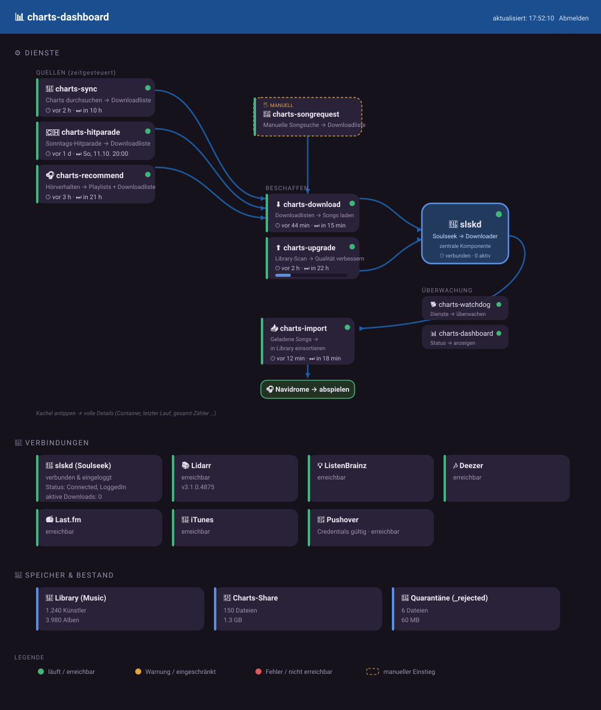

# charts-dashboard

Status-Weboberfläche für den charts-stack. Zeigt auf einen Blick, ob alle Dienste
laufen, ob die Verbindungen gesund sind und was jeder Dienst zuletzt verarbeitet
hat.

Monitoring-Dienst der `charts-*`-Familie, zusammen mit
[`charts-watchdog`](../charts-watchdog) (Pushover-Alarm ohne UI).

---

## Aufbau

Die Dienste werden als **Datenfluss** dargestellt – man sieht auf einen Blick,
was wohin fließt, was automatisch läuft und was manuell gestartet wird. **slskd**
steht als zentrale Komponente im Zentrum, durch die alle Downloads laufen.

- **Quellen** (zeitgesteuert) erzeugen Downloadlisten: `charts-sync`,
  `charts-hitparade`, `charts-recommend`. `charts-songrequest` ist der **manuelle**
  Einstieg (mit „MANUELL"-Markierung in der Kachel).
- **Beschaffen:** `charts-download` (aus den Downloadlisten) und `charts-upgrade`
  (Library-Scan auf schlechte Qualität) stoßen Downloads über **slskd** an.
- **Einsortieren:** `charts-import` legt die geladenen Songs getaggt in die
  Library → **Navidrome** (externes Ziel, als grüne Pille dargestellt).
- **Überwachung & Report:** `charts-watchdog`, `charts-dashboard` und
  `charts-digest` (tägliche Pushover-Zusammenfassung) stehen rechts in einer
  eigenen „Überwachung & Report"-Zone (nicht im Datenfluss), als gestapelte
  Kacheln mit gleichmäßigem Abstand.

> **Fehlt eine Dienst-Box?** Dienste, die **keine** Statusdatei schreiben
> (`charts-watchdog`, `charts-dashboard`), werden nur angezeigt, wenn sie in der
> `WATCH_CONTAINERS`-Variable (zentrale `.env`) gelistet sind. Taucht eine Box
> nicht auf, zuerst dort prüfen – die `.env` überschreibt den Code-Default.

Jede Dienste-Kachel zeigt kompakt Status-Ampel, „was → wohin" und **wann zuletzt
gelaufen / wann wieder**; ein Klick/Tap klappt die vollen Details auf
(Container-Zustand, letzter Lauf, kumulative Gesamtzahlen, bei `charts-upgrade`
der Scan-Fortschritt). `slskd` ist als zentrale Komponente standardmäßig
aufgeklappt. Die Kacheln lassen sich mit der Maus **frei verschieben**
(Verbindungslinien folgen); ein Reload stellt die Standard-Anordnung wieder her.

## Was es zeigt

- **Verbindungen:** EINE Übersicht aller externen/abhängigen Dienste mit
  einheitlicher Farbsemantik – **grün** = erreichbar/gültig, **rot** =
  konfiguriert aber nicht erreichbar/ungültig, **grau** = nicht konfiguriert,
  **gelb** = erreichbar aber eingeschränkt (z. B. iTunes gedrosselt). Enthalten:
  slskd (beim Soulseek-Server eingeloggt? aktive Downloads), Lidarr, ListenBrainz,
  Deezer, Last.fm, iTunes, Pushover und **FLASHBACK FM** (GraphQL-Live-Check der
  LastPlayed-Query: toter persisted-query-Hash → rote Kachel → Signal
  „`FLASHBACK_HASH` neu holen"; ohne Hash grau/muted). So sieht man auf einen
  Blick alle möglichen Verbindungen und ihren Live-Zustand.
- **Dienste:** je Container der Docker-Zustand (läuft / healthy / gestoppt) in
  der Reihenfolge der Verarbeitungskette, plus die **exakte Lauf-Statistik**:
  wann der letzte Lauf war, ob er erfolgreich war, was er verarbeitet hat
  (z. B. „6 importiert, 2 übersprungen") und die kumulativen Gesamtzahlen. Die
  „nächster Lauf"-Angabe nennt im Bereich 1–24 h bewusst **Stunden UND Minuten**
  (z. B. „in 1 h 50 min"), damit 1h50 nicht irreführend als „in 1 h" erscheint;
  ein überfälliger Lauf wird ehrlich als „überfällig" angezeigt.
- **Speicher & Bestand:** Dateizahl/Größe des Charts-Share und der Quarantäne.

Die Seite aktualisiert sich automatisch (Standard alle 15 s).

## Quellen-Finder (neue Chart-Quellen finden)

Unten auf der Seite steht ein eigenes Panel (unabhängig vom Flow-Diagramm), das
beim Zusammenstellen der `charts-sync`-`CHARTS`-Liste hilft – man muss die IDs
nicht mehr von Hand aus Weblinks fummeln:

- **Deezer-Playlist-Suche:** Suchbegriff eingeben → passende Playlists mit ID
  und einem **fertigen JSON-Snippet** zum Kopieren
  (`{"service":"deezer","type":"playlist","source":"<id>",…}`).
- **Deezer-Künstler-Suche:** Künstlernamen eingeben (z. B. `Gölä`, `Polo Hofer`)
  → passende Künstler mit ID und Fan-Zahl (hilft, gleichnamige Künstler zu
  unterscheiden) sowie ein **fertiges Snippet** für die Top-Tracks des Künstlers
  (`{"service":"deezer","type":"artist","source":"<id>",…}`).
- **Deezer-Genre-Tabelle:** die stabilen Genre-IDs als Liste (1×/Tag gecacht,
  Refresh beim ersten Aufruf nach Ablauf – siehe `DASHBOARD_GENRE_CACHE_TTL`).
  Fällt der Live-Call aus, greift eine eingebaute statische Fallback-Liste.
- **Last.fm-Tag-Prüfung:** einen Tag (z. B. `country`) eingeben → prüft via
  `tag.getTopTracks`, ob er brauchbar ist, und zeigt das passende Snippet
  (`{"service":"lastfm","method":"tag.getTopTracks","tag":"<tag>",…}`). Dieser
  Teil ist **nur mit `LASTFM_API_KEY`** aktiv; ohne Key ist er ausgegraut.

Jedes Snippet lässt sich kopieren und direkt in die `CHARTS`-Variable der
`.env`/`compose.yml` einsetzen. Volle Referenz: [`CHARTS-SOURCES.md`](../CHARTS-SOURCES.md).

## Woher die Daten kommen

- **Container-Zustand:** read-only über den `charts-docker-proxy` (`inspect`),
  **nicht** direkt über den Docker-Socket.
- **slskd / Lidarr:** direkte API-Abfrage (`/api/v0/server` bzw. `system/status`).
- **Externe Live-Checks:** billige Pings gegen ListenBrainz, Deezer, Last.fm,
  iTunes, Pushover und FLASHBACK FM – gecacht (Default 120 s, entkoppelt vom
  15-s-Poll).
  ListenBrainz/Deezer/Last.fm **heilen** einen gespeicherten `error` des
  zugehörigen Dienstes: ist die Quelle live erreichbar, wird die Dienste-Kachel
  **gelb** („läuft wieder") statt hart **rot**. FLASHBACK FM wird per
  GraphQL-LastPlayed-Query geprüft und heilt `charts-flashback` genauso; ein
  toter persisted-query-Hash macht die Kachel rot (Signal: `FLASHBACK_HASH` neu
  holen), ohne Hash bleibt sie grau. iTunes (Cover) und Pushover sind
  reine Info und heilen **kein** Dienste-Rot. Pushover prüft die Credentials jetzt
  mit einem echten `validate`-Call (verbraucht kein Nachrichten-Budget) statt nur
  ein configured-Flag anzuzeigen. Last.fm braucht einen API-Key – ohne Key bleibt
  die Kachel grau (nicht rot).
- **Lauf-Statistik:** jeder charts-Dienst schreibt am Ende eines Laufs eine kleine
  JSON-Datei nach `Charts/.charts-status/<dienst>.json`. Das Dashboard liest nur
  diese Dateien – kein Log-Parsing, keine Laufzeit-Kopplung an die Dienste.

## Login

Das Dashboard hat einen **eigenen** Login, getrennt von charts-songrequest (es
zeigt interne Zustände):

- `DASHBOARD_USERNAME` (Default `admin`) + `DASHBOARD_PASSWORD`.
- Ist `DASHBOARD_PASSWORD` leer, fällt es auf die gemeinsamen
  `APP_USERS`/`APP_PASSWORD` zurück.

Ohne gültigen Login startet der Dienst nicht (die Seite kann von außen erreichbar
sein).

## Konfiguration (zentrale `.env`)

| Variable | Default | Zweck |
| --- | --- | --- |
| `DASHBOARD_PORT` | `5057` | Host-Port der Web-UI |
| `DASHBOARD_REFRESH_SECONDS` | `15` | Auto-Refresh-Intervall |
| `CHARTS_LANG` | – (leer = Englisch) | Sprache für UI **und** Logs (`de`/`fr` verfügbar) – stackweiter Schalter, kein eigener UI-Umschalter |
| `DASHBOARD_DONATE` | `1` | dezenter Spenden-Footer (PayPal/Revolut); `0`/`false`/`no` blendet ihn aus |
| `DASHBOARD_USERNAME` | `admin` | Benutzername fürs Dashboard |
| `DASHBOARD_PASSWORD` | – | Passwort (leer = Fallback auf `APP_USERS`) |
| `SLSKD_API_KEY` | – | für slskd-Status (Pflicht im Stack) |
| `LIDARR_URL` / `LIDARR_API_KEY` | – | optional, für den Lidarr-Check |
| `LASTFM_API_KEY` | – | optional, für den Last.fm-Live-Check (leer = Kachel grau) |
| `PUSHOVER_TOKEN` / `PUSHOVER_USER` | – | optional, für den Pushover-`validate`-Check |
| `DASHBOARD_EXTERNAL_TTL` | `120` | Cache-TTL der externen Live-Checks (Sekunden) |
| `DASHBOARD_GENRE_CACHE_TTL` | `86400` | Cache-TTL der Deezer-Genre-Tabelle im Quellen-Finder (Sekunden; Refresh beim ersten Aufruf nach Ablauf) |
| `WATCH_CONTAINERS` | alle charts-Dienste | welche Container angezeigt werden – Dienste **ohne** Statusdatei (z. B. `charts-watchdog`, `charts-dashboard`) erscheinen NUR, wenn sie hier gelistet sind |

## Zugriff

Im LAN direkt über `http://<host>:5057`. Für den Zugriff von außen hinter einen
Reverse Proxy legen (z. B. `status.deine-domain.tld` → `http://<host>:5057`,
kein WebSocket nötig) und **HTTPS** verwenden – das Login nutzt ein Session-Cookie.

## Sicherheit

- Läuft als **unprivilegierter User** (youruser, `PUID:PGID`), **nicht** als root.
- **Kein** direkter Docker-Socket-Zugriff: Container-Zustände werden ausschließlich
  **read-only** über den `charts-docker-proxy` abgefragt
  (`DOCKER_HOST=tcp://charts-docker-proxy:2375`). Der Proxy lässt nur lesende
  Abfragen durch – Container starten/stoppen/exec ist blockiert.
- Mountet Charts/Music **read-only**.

## Sprache & Spenden

- Das Dashboard folgt dem stackweiten `CHARTS_LANG` (leer = Englisch; `de`/`fr`
  verfügbar). Ein Schalter für den ganzen Stack, kein eigener UI-Umschalter –
  Sprache ändern = `.env` anpassen + Container neu starten (kein Rebuild, die
  Sprachdateien kommen read-only aus dem `/lang`-Mount).
- Ein dezenter **Spenden-Footer** (PayPal/Revolut) ist standardmäßig an und über
  `DASHBOARD_DONATE=0` abschaltbar.
- Hinweis: Die beiden Spenden-URLs stehen **zweimal** – im Footer von
  `app/static/index.html` (bzw. `_DONATE_FOOTER` in `app/main.py`) und in
  `.github/FUNDING.yml` (GitHub liest diese Datei statisch). Beide sind
  **absichtlich unabhängig** – ändert sich ein Handle, beide Stellen anpassen.

> 🇬🇧 English version: [README.en.md](README.en.md)
